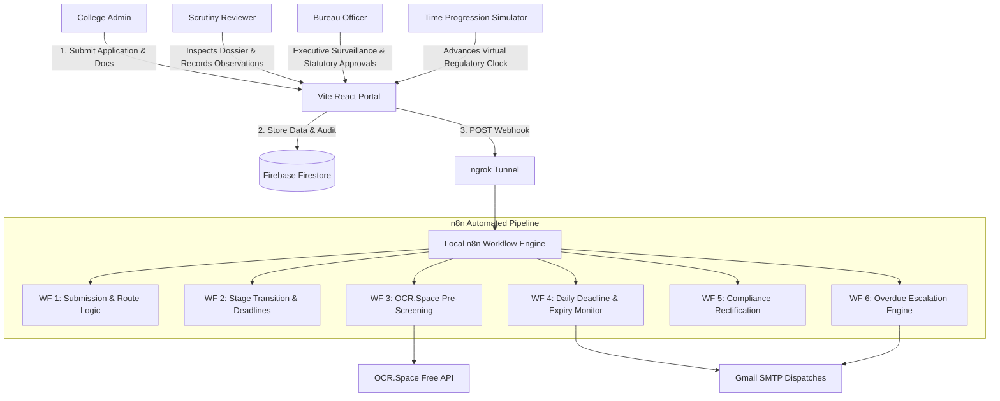

# Integrated AICTE Approval Workflow Automation, Compliance Monitoring and Alert Management System
### Problem Statement ID: 26262 | AICTE Hackathon Prototype

---

## 🏛️ Executive Summary

This enterprise-grade prototype automates repetitive administrative scrutiny, compliance monitoring, and statutory escalation workflows for technical education approvals under the **All India Council for Technical Education (AICTE)**.

Built strictly in accordance with **APH (Approval Process Handbook 2026-27)** norms, the system:
1. **Automates Routine Administrative Workflows** (application validation, stage transitions, reminder dispatches, and deficiency notices) via self-hosted **n8n** automation engine.
2. **Preserves Statutory Authority**: Automates workflow routing without replacing statutory scrutiny, inspections, or final approval decisions reserved for authorized AICTE officials.
3. **Monitors Real-Time Document Compliance**: Color-coded surveillance for Fire NOCs, Building Completion Certificates, and Structural Stability Certificates with OCR pre-screening.
4. **Enforces Multi-Tier Statutory Escalations**: Triggers Tier-1 reminders, Tier-2 Bureau Officer alerts, and Tier-3 Appellate referrals when deadlines lapse.
5. **Simulates Time Progression**: Built-in demonstration clock advancing time by +7, +15, or +30 days to demonstrate live expiry, reminders, and escalations to hackathon judges.

---

## 🛠️ Mandatory Technology Stack (Zero-Cost Operation)

| Layer | Technology | Cost / Plan | Notes |
| :--- | :--- | :--- | :--- |
| **Frontend** | React 19 + Vite | Free / MIT | Responsive design, modern Indian enterprise visual style |
| **Styling** | Tailwind CSS + Lucide Icons | Free / MIT | Custom AICTE branding, glassmorphism, badge matrices |
| **Charts** | Recharts | Free / MIT | Stage distributions, regional scrutiny latency, compliance scores |
| **Authentication** | Firebase Auth (Web SDK v13) | Free Tier (Spark) | Role-Based Access Control: College Admin, Reviewer, Bureau Officer |
| **Database** | Firebase Cloud Firestore | Free Tier (Spark) | Real-time listeners for applications, documents, audit logs |
| **Automation** | Local Self-Hosted n8n | Free / Community | 6 distinct automated workflows exposed via ngrok |
| **Webhook Tunnel** | ngrok | Free Tier | Configured at `https://emphasize-latrine-backlog.ngrok-free.dev` |
| **Email Dispatch** | Gmail SMTP via n8n | Free Quota | Google App Password authentication (`salemranjan@gmail.com`) |
| **OCR Processing** | OCR.Space Free API | Free Quota | API Key `K8959362988051188957` (extracts text & keyword conformity) |
| **Signature Heuristic** | Python 3 + OpenCV | Free / Open Source | Local stroke density & contour heuristic (`scripts/signature_detector.py`) |

---

## 🏗️ System Architecture



---

## 👥 Role-Based Access Control (RBAC) Matrix

| Feature / Permission | College Admin | Scrutiny Reviewer | Bureau Officer |
| :--- | :---: | :---: | :---: |
| **Submit New Applications & Upload Documents** | ✅ | ❌ | ❌ |
| **View Institutional Dossier & Timeline** | ✅ (Own) | ✅ (Assigned Region) | ✅ (National) |
| **Inspect OCR Pre-Screening & Document Text** | ❌ | ✅ | ✅ |
| **Conduct Scrutiny & Approve Current Stage** | ❌ | ✅ | ❌ |
| **Raise Statutory Deficiency (7-Day Clock)** | ❌ | ✅ | ❌ |
| **Submit Rectification Evidence & Undertakings** | ✅ | ❌ | ❌ |
| **Schedule Expert Visit Committee (EVC)** | ❌ | ✅ | ✅ |
| **Grant Final Statutory AICTE Approval / Rejection** | ❌ | ❌ | ✅ |
| **Surveil Overdue Files & Level 2 Escalations** | ❌ | ⚠️ (Notified) | ✅ (Full Authority) |
| **Immutable Audit Trail & Regional Reports** | ❌ | ✅ (View) | ✅ (Executive Full) |

---

## ⚡ Quick Start Instructions

### 1. Run the Frontend Application
```bash
# Navigate to the project directory
cd c:\data\EPR

# Install dependencies (already prepared)
npm install

# Start the Vite local development server
npm run dev
```
Open **[http://localhost:5173](http://localhost:5173)** in your browser.

---

### 2. Configure Local n8n Instance
Start your local n8n server:
```bash
npx n8n
```
Import the 6 workflow JSON files located in `c:\data\EPR\n8n-workflows/`:
1. `1_application_submission_and_routing.json` (`/webhook/application-submit`)
2. `2_application_review_and_stage_transition.json` (`/webhook/application-review`)
3. `3_document_prescreening_ocr.json` (`/webhook/document-upload`)
4. `4_daily_deadline_and_expiry_monitoring.json` (`/webhook/simulate-time`)
5. `5_compliance_submission.json` (`/webhook/compliance-submit`)
6. `6_overdue_escalation.json` (`/webhook/escalation-check`)

Activate each workflow inside n8n.

---

### 3. Expose n8n with ngrok
In a separate terminal:
```bash
ngrok http 5678 --url=emphasize-latrine-backlog.ngrok-free.dev
```

---

## 🧪 Hackathon Demonstration Scenarios

Use the **Persona Switcher** in the top navigation bar to switch between user roles instantly.

### Scenario A: Successful Application Progression
1. **Switch to "College Admin"**:
   - Notice Application `AICTE-2026-8841` (*Apex Institute of Engineering & Technology*).
   - Route: `Scrutiny followed by EVC`.
   - Documents: Fire Safety, Occupancy, Structural Safety verified and valid.
2. **Switch to "Reviewer"** (*Dr. R. Ramanathan*):
   - Open Scrutiny Queue & click **Conduct Scrutiny** on `AICTE-2026-8841`.
   - Review observations and click **Approve Current Stage**.
   - Notice the system automatically transitions the stage to `Pending EVC` and recalculates the stage deadline.
   - Set an EVC inspection date and click **Schedule EVC Visit**.
3. **Switch to "Bureau Officer"** (*Sh. M. K. Verma*):
   - Notice the application in the national pipeline.
   - Open file and click **Grant Statutory Approval**.
   - The application is finalized, marked as statutory approval granted, and logged in the immutable audit trail.

---

### Scenario B: Deficiency and Overdue Escalation
1. **Switch to "Reviewer"**:
   - Inspect Application `AICTE-2026-9024` (*Greenfield Institute of Technology*).
   - Notice the expired Fire Safety Certificate.
   - Click **Raise Deficiency (7-Day Clock)**. The status updates to `Deficiency Raised` with a strict 7-day correction deadline.
2. **Advance Time using "Simulate Time Progression"**:
   - Click the **Advance Time** button in the header.
   - Select **+15 Days** and click Run.
   - Observe the live evaluation:
     - The correction deadline lapses.
     - The application is automatically escalated to **Level 2 - Bureau Officer Alert**.
     - An automated notification is recorded in the dispatch ledger.
3. **Switch to "College Admin"**:
   - Notice the urgent deficiency warning banner.
   - Click **Upload Rectification Evidence**, enter renewal details, and submit.
   - Status updates to `Resubmitted` and returns to the reviewer scrutiny queue.
4. **Audit Trail Verification**:
   - Navigate to the **Audit Trail** tab to view the tamper-evident log capturing each simulated time tick, actor UID, previous status, and new status.

---

## 📄 File Structure

```
c:\data\EPR/
├── .env                              # Active environment variables
├── .env.example                      # Template for secrets
├── firestore.rules                   # Role-based Firestore security rules
├── index.html                        # HTML entry point with AICTE typography
├── package.json                      # Dependencies & build scripts
├── vite.config.js                    # Vite configuration with Tailwind CSS v4
├── n8n-workflows/                    # Exportable / importable n8n workflows
│   ├── 1_application_submission_and_routing.json
│   ├── 2_application_review_and_stage_transition.json
│   ├── 3_document_prescreening_ocr.json
│   ├── 4_daily_deadline_and_expiry_monitoring.json
│   ├── 5_compliance_submission.json
│   └── 6_overdue_escalation.json
├── scripts/
│   └── signature_detector.py         # Python OpenCV heuristic script
└── src/
    ├── App.jsx                       # Main application shell & router
    ├── index.css                     # Tailwind tokens, fonts, animations
    ├── main.jsx                      # React 19 DOM entry
    ├── components/
    │   ├── Header.jsx                # Emblem, persona switcher, clock badge
    │   ├── Sidebar.jsx               # Role-based sidebar navigation
    │   ├── TimeSimulationModal.jsx   # Safe virtual time progression engine
    │   └── ApplicationDetailModal.jsx# Scrutiny desk & file inspector
    ├── context/
    │   └── AppContext.jsx            # State management, RBAC, live Firestore sync
    ├── data/
    │   └── mockData.js               # Seed data for Scenario A and Scenario B
    ├── firebase/
    │   └── config.js                 # Firebase Auth & Firestore initialization
    ├── services/
    │   ├── api.js                    # n8n webhook caller & local resilience engine
    │   └── ocrService.js             # OCR.Space API caller & keyword analyzer
    └── views/
        ├── CollegeDashboard.jsx      # Institutional administrative desk
        ├── ReviewerDashboard.jsx     # Scrutiny committee inspection desk
        ├── BureauDashboard.jsx       # Consolidated executive command console
        ├── ApplicationsList.jsx      # National application registry
        ├── NewApplicationForm.jsx    # Multi-step statutory submission form
        ├── DocumentManagement.jsx    # Color-coded certificate validity matrix
        ├── ComplianceView.jsx        # Deficiency rectification tracker
        ├── EvcManagement.jsx         # Expert Visit Committee administration
        ├── AlertsEscalationView.jsx  # Escalation tiers & Gmail SMTP logs
        ├── AuditTrailView.jsx        # Immutable event ledger
        ├── ReportsView.jsx           # Recharts visual analytics
        └── N8nEngineView.jsx         # Live n8n webhook test bench
```

---

## 🔒 Security & Statutory Compliance Principles

- **No Secret Exposure in Frontend**: Secrets and API keys are stored in environment variables.
- **Resilient Fallback Engine**: If the ngrok tunnel is offline or n8n webhooks are paused, the application's built-in resilience engine handles updates transparently so live hackathon presentations never crash.
- **Strict Human Oversight**: OCR and automated pre-screening provide guidance only; legal approvals strictly require an authorized officer's decision.
